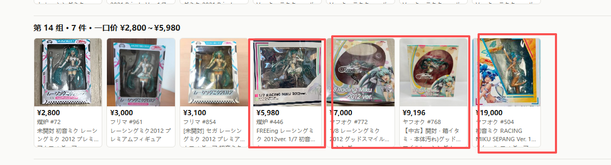

# 格银西里尔

单人自用的跨平台日淘搜索、关键词订阅与指定商品降价/补货监控系统。

## 重点：用视觉模型给二手商品图「找同款」，并用人工考卷评测

一个关键词在日本各个二手平台能搜出上千件商品，其中大量是同一款东西被不同卖家挂了很多次。
这一部分要做的，是把这些商品**按图片自动合并成「同一款」**，并且证明合并结果是对的。

**原则：宁可少合，不能合错。** 少合，只是多看一张卡片；合错，一件不同的商品就被藏进了折叠里。

### 做法：四步配合，只看图片不够

| 步骤 | 做什么 | 用到的模型 / 方法 |
|---|---|---|
| ① 图片提名 | 给每张图算「指纹」，把像的先归到一组 | DINOv2-large（看长相）+ SigLIP-so400m（看是什么），分层聚类 |
| ② 标题否决 | 标题里写明了不同（年份、比例 1/7 和 1/8、厂商、版本、周边种类），图再像也拆开 | 规则（`titlerules.py`） |
| ③ 多件合拍排除 | 一张照片里拍了好几件不同商品的，不参与合并 | Qwen2.5-VL-7B 看图判断 |
| ④ 细节复核 | 数两张图上能一一对上的细节点，对不上的拆开 | DISK 特征点 + LightGlue + MAGSAC |

### 评测：人工考卷 + 一份不调参的留出集

- **考卷**：在第 1 轮结果的图片墙上，人工把错误的合并圈出来，录成 `exam.py`。每改一次规则都拿它打分。
  标注截图见 [`experiments/image-dedup/exam-screenshots/`](experiments/image-dedup/exam-screenshots/)。
- **防止"背答案"**：第二份数据（鸣濑白羽 872 件）一个参数都没对着它调，只用来检查。
- **人工圈出的错误分三类**：一张照片拍了好几件；同系列不同版本（标题里写着区别）；纯粹看错。每一类都对应上面的一步。

| 版本（赛车初音 1008 件） | 卡片数 | 该合的合上 | 不该合的被合上 |
|---|---|---|---|
| 第 1 轮：只看图片 | 591 | 446/446 | **85 对** |
| 第 2 轮：四步配合 | 622 | 386/391 | **0 对** |
| 第 3 轮：补标题规则 + 第二轮标注 | 625 | 414/419 | **0 对** |

结果：初音 1008 件合成 622 张卡片（只按标题去重是 879 张），白羽 872 件合成 634 张（标题去重 750 张）。
两轮实验在 Modal GPU 上一共花了 **$1.68**。



### 文件在哪

- [`experiments/image-dedup/`](experiments/image-dedup/)：实验本体，包括 1008 张商品图、考卷、标注、向量、比对结果、图片墙（`wall*.html`）
- [`apps/image-dedup/`](apps/image-dedup/)：上线版服务；`check_exam.py` 离线阅卷，考卷必须 0 错才能改规则
- [`docs/研究/图片去重-实测-20261008.md`](docs/研究/图片去重-实测-20261008.md)：完整实验报告，含每一步的数字和踩过的坑
- [`docs/研究/精确同款按参考图找货-调研-20261009.md`](docs/研究/精确同款按参考图找货-调研-20261009.md)：拿一张参考图找精确同款的调研
- [`docs/长期研究/二次元周边视觉模型.md`](docs/长期研究/二次元周边视觉模型.md)：后续计划

---

## 架构

- `apps/web`：Next.js App Router + OpenNext Cloudflare 管理站
- `apps/collector`：独立 Cloudflare Worker，Cron + Queue 消费
- `apps/mercari-service`：Vercel 东京区的固定用途来源适配服务（沿用历史目录名），只接受 Collector 的短时 ECDSA 签名请求，只能访问代码内固定的 Mercari、骏河屋、Yahoo! Shopping 实验搜索、CharaON、COSPA 与 Animate 端点
- `apps/source-runner`：新加坡 VPS 上的公开 HTML 采集服务，同样只接受 ECDSA 签名请求，请求只携带来源与操作而非任意 URL
- `packages/core`：统一领域类型、状态哈希与事件算法
- `packages/adapters`：Rakuten 正式 API、Amazon Japan / Yahoo 匿名公开 HTML、Mercari 内部 API，以及骏河屋 / CharaON / COSPA / Animate 公开页面适配器
- `packages/db`：VPS PostgreSQL/Hyperdrive 运营数据库 repository
- `packages/analytics`：面向外部分析工作台的确定性证据读取、质量统计与清洗候选抽取
- `packages/email`：Resend REST API 与邮件模板
- `packages/notifications`：Hermes Webhook HMAC 签名与有界 HTTP 传输
- `postgres/schema.sql`：VPS PostgreSQL 的 `radar_core` 与 `radar_analytics` 统一完整基线
- `postgres/migrations`：基线之后的 `radar_core` 增量迁移
- `supabase/migrations`：`radar_analytics` 的历史 PostgreSQL 迁移来源。该 schema 已迁入 VPS 的统一 `jpgr` 数据库；切换验收前保留这些历史，不再把 Supabase 当作目标运行库

产品边界：应用负责搜索、监控、定时行情采样、原始证据保存和逐条语义清洗，不再提供 `/analytics` 页面或手动 AI 行情报告。临时探索、图表和深度行情分析统一在外部 Databricks 工作区完成；即使外部分析额度耗尽，采集与证据链也会继续独立运行。

代码仓库边界：Databricks Notebook、分析任务等外部分析代码在另一个私有仓库，本仓库只保留应用代码、PostgreSQL schema 和对外数据契约。

## 统一 PostgreSQL 迁移状态

VPS PostgreSQL 17 的 `jpgr` 数据库同时承载：

- `radar_core`：搜索、监控、Queue 与通知等运营数据；
- `radar_analytics`：原 Supabase 分析数据；
- `jpgr_meta`：迁移版本与导入快照证据。

Collector 的 `ANALYTICS_DB`、Collector/Web 的 `PRIMARY_DB` 都指向同一个私有 Hyperdrive 配置，经 Workers VPC 和 Cloudflare Tunnel 访问 VPS。VPS PostgreSQL 是唯一生产运营数据库，不存在数据库模式切换或备用数据库分支。

可重复验证命令：

```powershell
# 436 条静态/代表性动态 SQL 在真实 PostgreSQL schema 下 PREPARE
node scripts/validate-postgres-operational-sql.mjs |
  ssh root@<VPS> "sudo -u postgres psql -X -d jpgr"

# 部署一个带随机令牌的只读临时 Worker，验证真实 Hyperdrive 链路后自动删除
.\scripts\verify-hyperdrive-deployment.ps1

# 用独立 PostgreSQL 17 容器运行 Worker 集成测试
pnpm test:workers
```

## 本地开发

```powershell
pnpm install
pnpm cf:types
pnpm --filter @jpgr/collector dev
pnpm --filter @jpgr/web dev
```

复制 `.dev.vars.example` 为对应应用的 `.dev.vars` 并填写本地值。管理员密码摘要为：

```text
HMAC-SHA256(ADMIN_AUTH_SECRET, 管理员密码)
```

管理员会话是自包含的签名令牌（`SESSION_SIGNING_SECRET`），有效期 7 天，服务端不保存会话状态。因此"退出登录"只清除本机 Cookie；需要立即作废所有已签发会话（例如 Cookie 可能已泄露）时，轮换签名密钥即可：

```powershell
pnpm --filter @jpgr/web exec wrangler secret put SESSION_SIGNING_SECRET
```

登录端点的暴力破解防护由 Cloudflare 控制台的 WAF 速率限制规则承担，不在应用代码内实现；`ADMIN_PASSWORD_DIGEST` 对应的密码必须是长随机串。

## 单品自动调频

单品降价 / 库存监控支持自动调频与固定频率。在单品的「检查计划与来源控制」中选择固定频率、每 30 分钟，即可锁定重点商品；固定频率仍遵守现有夜间暂停与来源冷却。

自动调频只适用于 `dossier_kind=item`、`kind=item`、`monitoring_purpose=item_price` 的非拍卖单品。精确商品发现、精确商品的独立报价跟踪和关键词雷达均保持原有调度。新建与已有符合条件的单品默认自动调频，首次有效检查建立独立基线；不会把历史创建时间直接当成稳定时间。

每累计 24 小时有效稳定观察，间隔延长约 25%，每次成功检查最多延长一次；小幅价格变化时缩短一半并观察 24 小时，确认降价 / 目标价信号或库存状态变化时恢复基础频率并观察 48 小时。间隔带约 ±10% 的随机浮动，限定在基础频率与用户选择的 24 / 48 / 72 小时上限之间（默认 72 小时）。夜间暂停、失败、缺失字段和异常检查空档不计入稳定时间；手动检查不会推迟既定检查时间。

配置与独立价格 / 库存基线保存在现有 `watch_bindings.source_config_json.itemSchedule` 中，不需要数据库迁移或模型服务。写回采用条件更新，防止执行中的任务覆盖用户刚设置的固定频率。

## 关键词上新窗口

关键词上新用「回溯到重叠为止」做增量：来源按最新在前返回结果，采集一直往回翻，直到本页完全落入既有覆盖范围为止。收敛判据是集合判据而不是顺序判据——**只要本页还存在没见过的、或比水位线新的商品就继续翻，整页都已覆盖才停**。

不能用"撞上任意一个已知 ID 就停"，因为只有一部分来源按上架时间排序：Rakuten Ichiba 用 `-updateTimestamp`、骏河屋用 `modificationTime`，老商品改一次价就跳回第一页；Yahoo! Shopping 与 COSPA 根本不支持排序，返回的是相关度序。按旧判据，一个被顶回首页的老商品就能把整轮回溯截断在第三位，真正的新品还在它下面读不到。

每个绑定有两个锚点字段：

- `watch_bindings.new_listing_watermark`：已覆盖到的最新上架时间。只在采集成功后单调推进，从不回退，未来时间戳会被丢弃。生产中只有 Mercari、Yahoo!オークション、Yahoo!フリマ 返回上架时间，其余来源该字段恒为空，此时收敛完全退化为 ID 差集。
- `watch_bindings.new_listing_anchored_at`：首次深度锚定完成的时间。为空表示还没有可信的深度基线，下一轮会用更大的页预算（`max(来源日常预算, 8)`，不超过来源上限）重新锚定；**该轮不产生上新通知**，深挖出的存量按初始基线渲染，避免把早就在架的商品当成当天新品刷屏。锚定轮也不参与结果窗口换血检测，因为"几乎全是没见过的商品"正是它的预期结果。

`source_health_snapshots.cursor_termination_reason` 的 `budget_reached` 现在精确表示**本轮覆盖不完整**：页预算耗尽而窗口仍未回溯到既有覆盖范围。旧实现只看上游是否还有下一页，正常收敛的轮次也被记成 `budget_reached`，掩盖了真正被截断的那些轮。被截断时另有 `keyword_new_listing_window_truncated` 结构化日志。

`new_listing` 事件的 `payload.discoveryKind` 区分三种发现口径：`listed_new`（来源上架时间确认晚于水位线）、`newly_seen`（我们第一次看见，但无法证明是新上架）、`recovered_match`（此前采集过、规则修正后才通过相关性）。摘要把 `listed_new` 一律记作新增，不再被"以前观察过这个 ID"的启发式改判成回收。

上新闸门只排除终局状态（售罄 / 下架），不要求商品可购买。库存状态未知不等同于不可买：Yahoo! Shopping 的公开搜索页没有库存字段，归一化后 `availability` 恒为 `unknown`，用可购买白名单做闸门会让整个来源永久静默——采集、匹配、AI 判定全部照常执行并计入 `new_count`，但一条通知都发不出来，后台证据页也因为同一个过滤条件显示为空。后台 `/api/watch-bindings/{id}/listings` 与闸门保持同一口径。

摘要条目上限（100 条）按来源轮转取样后再截断：候选按 `source_id` 排序，直接切前 N 条会把字母序靠后的来源整体切掉（生产中 317 条的初始基线只渲染了 100 条，`yahoo_*` 一条没露出）。发现类条目优先于初始基线条目。

## 验证

验证范围必须与改动风险相称。普通局部改动只运行受影响包的类型检查、lint 或对应测试文件，例如：

```powershell
pnpm --filter @jpgr/web typecheck
pnpm --filter @jpgr/web lint
pnpm exec vitest run tests/<相关测试>.test.ts
git diff --check
```

`pnpm test:all`、完整 Worker 集成测试、完整浏览器回归和生产构建只用于真正跨模块或高风险的改动，不作为每次提交的固定步骤。Workers 集成测试使用 Cloudflare 官方 `@cloudflare/vitest-pool-workers` 与独立 PostgreSQL 17 容器，覆盖 workerd、Queue consumer、Cron 手动触发、80 binding 调度上限、48 小时验收门禁和 fake Resend。

## 发布与回滚

Web 生产发布使用 Cloudflare Workers Builds：GitHub 只保存代码，提交直接推送到 `main` 后，由 Cloudflare 以 `apps/web` 为根目录运行 `pnpm run deploy`，完成 OpenNext 构建并部署到 Worker。仓库不使用 GitHub Actions、PR 合并门禁或 artifact 中转来构建和发布生产 Web。`apps/web` 的 `deploy` 脚本已前置 `typecheck` 与 `lint`，任一失败即中止发布。

Collector 仍手动发布，`pnpm deploy:collector` 依次执行类型检查并部署：

```powershell
pnpm deploy:collector
```

只想重新部署代码并跳过前置类型检查时使用 `pnpm deploy:collector:only`。PostgreSQL schema 变更与 Worker 发布分开执行，发布命令不会自动修改生产数据库。

回滚：

```powershell
pnpm exec wrangler versions list --config apps/collector/wrangler.jsonc
pnpm exec wrangler rollback --config apps/collector/wrangler.jsonc
```

Web 在 Cloudflare 控制台 Workers Builds 的 Deployments 页面回滚。PostgreSQL 数据使用 VPS 之外的 R2 加密备份恢复；Worker 代码回滚不会自动回滚数据库：

```powershell
powershell -File scripts/backup-vps-postgres-to-r2.ps1
powershell -File scripts/verify-r2-postgres-restore.ps1 -ObjectKey <daily/.../jpgr-....dump.gpg>
```

## Cloudflare 资源

- VPS PostgreSQL 17：数据库 `jpgr`，schema `radar_core`、`radar_analytics`、`jpgr_meta`
- Hyperdrive：`PRIMARY_DB` 与 `ANALYTICS_DB` 均经 Workers VPC 指向 VPS `jpgr`
- Queue：`jp-goods-radar-jobs`（消费并发上限 1）、`jp-goods-radar-gemini`（并发 1）
- 单人自用不限制档案或启用来源绑定总数；Collector 的旧配置名 `MAX_ACTIVE_BINDINGS=80` 仅控制每次调度各领取多少条到期绑定/商品追踪任务，超出的到期任务留给后续调度，不阻止建立或恢复档案。
- DLQ：`jp-goods-radar-dlq`、`jp-goods-radar-gemini-dlq`；死信正文、错误和投递次数先持久化到运营库再确认
- Parking Queue：`jp-goods-radar-parking`、`jp-goods-radar-gemini-parking`；DLQ 持久化连续失败约 100 分钟后进入无 consumer 的最终停车区，并按免费层上限保留 24 小时
- R2：私有桶 `jpgr-postgres-backups` 保存 VPS 之外的 AES-256 加密 `pg_dump` 与校验 manifest
- Collector Worker：`jp-goods-radar-collector`
- Web Worker：`jp-goods-radar-web`
- 生产地址：`https://eru.example.com/`
- Cron：`* * * * *`（每分钟只领取到期关注；每小时第 7 分钟执行心跳、保留清理、探针与维护）

运营历史保留窗口由每小时维护 tick 执行：capture 元数据与有界结构化响应 14 天、`watch_runs` 90 天、`listing_snapshots` 180 天、探针观测 90 天、心跳 30 天、已完成 Queue receipt 30 天、失败 receipt 180 天、死信 365 天、已结算 analytics outbox 30 天、已发送邮件投递与已结算事件 180 天、`search_history` 最近 50 组。HTML 只在采集进程内解析，数据库不保存完整网页正文；数据库保留响应状态、字节数、内容哈希和抽取后的商品字段。

异地备份使用：

```powershell
.\scripts\backup-vps-postgres-to-r2.ps1

# 对指定 R2 对象执行一次隔离数据库的完整恢复演练，成功后自动删除临时库
.\scripts\verify-r2-postgres-restore.ps1 `
  -ObjectKey "daily/YYYY/MM/jpgr-YYYYMMDDTHHMMSSZ.dump.gpg"
```

备份脚本在 VPS 端把 `pg_dump` 直接流式加密为 AES-256 文件，不落地明文 dump；上传 R2 后重新下载并校验 SHA-256，同时运行 `pg_restore --list`。恢复验证脚本会另建随机命名的临时数据库、完整 `pg_restore`、查询核心 schema/行数，再强制删除临时库；绝不覆盖 `jpgr`。恢复密钥只以当前 Windows 用户可解的 DPAPI blob 保存在 `%USERPROFILE%\.jpgr\postgres-backup-passphrase.dpapi`，不进入仓库、VPS 或 R2。更换电脑或 Windows 账户前必须把密钥另行安全托管，否则加密备份无法恢复。

Rakuten 凭据未配置时对应来源保持不可用，不会阻止 Worker 启动。Yahoo 实验来源不进入官方 API 门禁，服务端功能开关保持开启并分别积累独立的 48 小时 Probe。无需平台凭据的实验性来源必须通过真实连接测试后才可判定稳定。Rakuten、Resend、Hermes Webhook 与 Vercel 来源服务签名私钥只保存在托管平台的生产 Secret；仓库不保存或输出它们。

## Hermes 微信通知

Collector 可以把与邮件相同的业务通知通过 Hermes Agent 的 Webhook 投递到 Weixin。**该通道当前已停用**（`apps/collector/wrangler.jsonc` 的 `HERMES_NOTIFICATIONS_ENABLED` 为 `false`）：Hermes Webhook 自 2026-08 起持续返回 502，无法完成投递。代码保留是为了后续换成飞书或 Telegram 时复用渲染、签名、幂等与投递记录，届时只需替换传输实现与环境变量。通道停用只影响微信，邮件（Resend）与事件生成不受影响。

投递侧有两条硬边界，重新启用前不要移除：单条通知最多尝试 8 次，事件超过 3 天不再投递。取件是 `ORDER BY e.created_at ASC LIMIT 20`，没有这两条边界时，投不出去的历史通知会以 6 小时为间隔无限重投并长期占住队头（生产中出现过 `attempts=127`）。

邮件与 Hermes 分别使用 `email_deliveries` 和 `hermes_deliveries` 记录状态，任一通道失败都不会改变另一通道的成功、失败或重试结果。邮件侧的每日配额折叠与渲染失败只写 `events.email_suppressed_at`，不改 `events.status`，因此不会连带影响微信投递。

价格提醒覆盖确认后的下降与上涨；补货通知会在同一关注档案有足够已完成生命周期证据时附上历史在售时长中位数。Mercari、Yahoo!オークション、Yahoo!フリマ、eBay 这类一次性挂牌连续 7 天保持售罄/下架后，会自动停用对应单品绑定并发送“监控完成”通知；商家目录型 SKU 不会被该规则误停。

`HERMES_WEBHOOK_SECRET` 保存在 Collector 的生产 Secret 中，轮换方式：

```powershell
pnpm --filter @jpgr/collector exec wrangler secret put HERMES_WEBHOOK_SECRET
pnpm deploy:collector
```

首次完整配置生效时，Collector 会持久化通道启用边界，只投递边界附近及之后的新事件，不回放既有历史通知。请求使用 `X-Webhook-Timestamp`、`X-Webhook-Signature-V2` 和稳定的 `X-Request-ID`；微信 Token 只保留在 Hermes 服务器，不进入本仓库或 Cloudflare。

## 实验性来源边界

- Mercari Japan 分类为 `internal_api`，使用 `POST /v2/entities:search` 与 `GET /items/get`，每次请求生成 P-256 / ES256 DPoP；Cloudflare 通过 ECDSA P-256 签名调用固定用途的 Vercel 东京服务，只接收标准化商品数据；不使用登录态、Cookie、代理轮换或验证码绕过；
- 骏河屋分类为 `html_endpoint`，只读取公开 `/search` 与商品详情页，默认最近修改排序并最多读取前两页；生产主路径由 Cloudflare 直连，受限时只使用固定托管兜底，Collector 只接收标准化商品数据；
- Yahoo! Shopping 分类为 `html_endpoint` 实验来源：只读取固定域名的公开搜索 HTML 与页面内 `__NEXT_DATA__`，最多跟随三页同域 HTML `nextUrl`；分页至少间隔两秒，不调用私有 BFF、不接收登录 Cookie 或任意上游 URL，暂不支持成色、成交历史和单品回查；
- Yahoo!オークション分类为 `html_endpoint` 实验来源：在售搜索读取公开商品卡片，已结束搜索读取页面内 `__NEXT_DATA__`，详情读取标准 Product JSON-LD；请求通过 PostgreSQL 原子预约时隙保持低频，本地排队不计为上游失败，并保留短缓存、超时与熔断保护，不调用匿名私有 JSON 端点；
- Yahoo!フリマ分类为 `html_endpoint`：公开搜索和详情都读取页面内 `__NEXT_DATA__`；搜索 HTTP 404 仍需通过完整结构校验，空窗口必须明确声明零条结果，不能把任意 404 伪装成成功；
- CharaON、COSPA 与 Animate 分类为 `html_endpoint`，生产主路径由 Cloudflare 直接读取代码固定的公开搜索页和商品详情路径，东京签名服务仅作短期故障兜底；搜索层负责发现，详情层补全 JAN、厂商、作品、发售/预约日期、多图和规格；
- 所有实验性来源都只承诺滚动窗口，不宣称全站完整覆盖；schema、CAPTCHA、403 或异常空结果会失败关闭，不会生成批量下架事件；
- 任一实验性来源失败只暂停自身，不影响 Rakuten、Queue、PostgreSQL 或邮件链路。

Parse MCP / 托管抓取只作为维护与运行兜底，不进入 Cron 或普通成功路径。只有骏河屋东京固定服务经一次有界重试后仍返回可重试平台错误时，手动搜索才会调用固定的 Parse Marketplace 骏河屋端点。月度 200 次额度固定分为 140 次 MCP/适配器维护、40 次运行兜底和 20 次紧急保留；PostgreSQL 使用原子计数与 15 分钟 TTL 缓存，运行兜底到第 41 次会硬停止。

Amazon Japan 即时搜索与监控由 Collector 从 Cloudflare 直接读取 `amazon.co.jp` 的公开搜索 HTML，请求固定使用日文与 JPY 偏好，并只接受稳定 ASIN 商品链接。商品查询也通过 ASIN 搜索完成，避免依赖更容易触发验证的详情页；直连受阻时可按需使用 Browser Run 回退。该来源仍属于公开结果窗口的有限覆盖，不宣传成 Amazon 官方完整库存。

## Rakuten Web Service 合规边界

- 本项目由“格银西里尔”独立开发与运营，不是 Rakuten 官方网站，也不代表双方存在合作、认证或客服关系；
- 使用 Rakuten 数据的页面按来源隔离，并原样展示 Rakuten 指定的 Web Service 授权标识；商品链接优先使用 API 返回的 `itemUrl`；
- `/sources/rakuten` 是公开只读展示页，只提供固定关键词结果并做一小时边缘缓存，不把 API 凭据发送到浏览器；
- `RAKUTEN_APPLICATION_URL` 必须与 Rakuten 后台登记的生产 URL 完全一致；适配器会据此发送 Rakuten 新认证网关要求的 `Origin` 与 `Referer`；
- `RAKUTEN_AFFILIATE_MODE=false` 为默认值。只有明确接受适用的 Affiliate 约定并主动改为 `true` 后，Collector 才会把 Affiliate ID 加入请求；
- `RAKUTEN_PRIVATE_MONITORING_ENABLED=false` 为默认值。Rakuten Web Service 条款限制仅特定人员可访问环境中的使用，因此在取得平台明确许可前，Worker 会拒绝 Rakuten 私人订阅、定时监控和降价二次确认；
- 在 Rakuten 开发者后台登记的应用 URL 应与实际生产地址一致。公开页面并不等同于平台已经确认本项目满足全部条款；如用途有疑义，应以日文条款及 Rakuten 的书面答复为准。

参考：[Rakuten Web Service 授权标识](https://webservice.rakuten.co.jp/guide/credit)、[Rakuten Web Service 条款](https://webservice.rakuten.co.jp/guide/rule)。

## 当前完成度

- Web、Collector、Queue、Cron 与 Cloudflare 原生部署链路已上线；VPS PostgreSQL/Hyperdrive 是唯一生产运营数据库；
- 订阅/来源绑定 CRUD、暂停恢复、立即运行、来源测试、事件重试/抑制、商品详情与价格曲线已实现；
- 搜索可保存为关键词订阅，结果可保存为指定商品监控；
- Resend 已验证生产域名、真实投递、幂等重放与模拟退信；
- Rakuten Ichiba、Rakuten Books、Mercari、Yahoo 实验来源、骏河屋、CharaON、COSPA 与 Animate 适配器及离线 fixture 测试已完成；Yahoo 已切换到公开 HTML 并重新开始独立的 48 小时生产稳定性观察；
- 30 秒降价二次确认、429 `Retry-After`、parser failure 自动禁用、每日 digest 和 URL allowlist 已完成；
- 涨价提醒、补货生命周期参考与一次性挂牌自动完成通知已完成；主动晨报已停用；
- 后台展示 P0/最终验收进度；调度器支持 30 分钟到每天的档案频率，Cron 每小时第 7 分钟写入维护心跳，实验性来源测试启用后会各自启动独立 Probe；
- 凭据就绪后可从来源页运行第 40 节完整 P0 实测，逐项证据不会保存 credential 或带 credential 的 URL；
- Collector Cron 也会在检测到完整凭据后自动运行官方来源 P0；失败至少间隔 6 小时重试，已经完整通过的 Rakuten 来源不会在验证另一来源时被重复请求；
- v4 最终完成邮件有独立幂等记录，只有当前 27 项证据全部为 `passed` 才会自动发送；
- Rakuten 生产凭据已配置；Yahoo 实验来源不阻塞官方来源门禁。Mercari 已通过东京独立服务完成生产真实搜索并开始 48 小时稳定性验证；Yahoo 与骏河屋仍按各自生产观察结果独立判定。实时状态以来源控制台为准。
